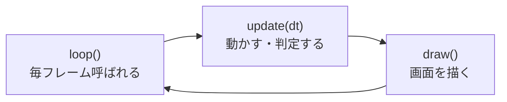
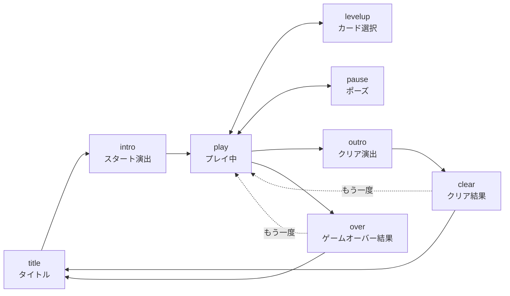
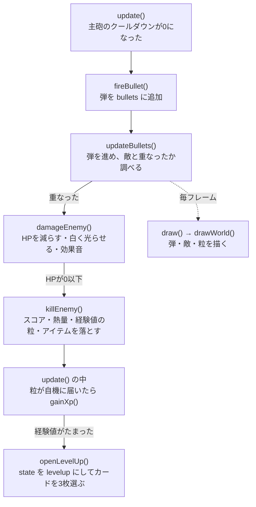

# TridentWave コード地図

このゲームのプログラムを **1行ずつ読まずに、どこが何を担当しているかをざっくりつかむ** ための地図です。

- 行番号は 2026年11月時点の目安です。コードを直すとずれるので、迷ったら **関数名で検索** してください(エディタの検索で `function update` などを探す)。
- 中身は必要になったときだけ読めば十分です。まずは「名前」と「順番」をつかみます。

---

## 1. ファイルの役割

| ファイル | 行数 | 担当 |
|---|---|---|
| `index.html` | 15 | ゲーム画面(canvas)を置いて、`config.js` → `game.js` の順に読み込むだけ |
| `style.css` | 4 | ページの見た目(画面の中央に置く、など) |
| `config.js` | 約390 | **数値の設定だけ**。敵の強さ・武器の性能・スコアなど。プログラムの動きは書いていない |
| `game.js` | 約2,300 | **ゲーム本体**。下の「game.js の地図」を参照 |
| `assets/` | ― | 画像とBGM |

バランスを変えたいときは `config.js` だけ、動きを変えたいときは `game.js` を触る、と分かれています。

---

## 2. いちばん大事な骨組み:ゲームループ

ゲームは **「更新する → 描く」を1秒に約60回くり返す** だけで動いています。昔の教本のSTGと同じ考え方です。

- `loop()`(ファイルのいちばん最後):心臓部。`requestAnimationFrame` で自分自身を毎フレーム呼び直します。
- `dt`:前のフレームから何秒たったか。動きは「速さ × dt」で計算するので、パソコンの速さが違っても同じ速さで動きます。
- `update(dt)` が動くのは **プレイ中(`state === "play"`)だけ** です。レベルアップ中やポーズ中は更新が止まり、描画だけが続きます。

### 画面の切り替え(state)

`state` という1つの変数で、今どの画面かを表しています。

「この画面のときだけ動く処理」は、たいてい `if (state === "levelup")` のように state で分けて書かれています。

---

## 3. game.js の地図

| 行(目安) | 担当 | 主な関数 |
|---|---|---|
| 1〜120 | 画像の読み込み・加工 | `loadImg` `loadEnemyImg` `whiteVersion`(被弾で光る白い絵を作る) |
| 121〜247 | 背景の子ども部屋を1枚の絵に焼き付ける | `bakeRoom` `drawSky` |
| 248〜360 | スタート演出・クリア演出(パタパタ) | `startIntro` `drawIntro` `startOutro` `drawOutroStage` |
| 361〜410 | 一覧づくり、**紙のUIの共通部品** | `uiFont` `paperPanel` `uiBackdrop` |
| 411〜457 | ゲームの長さ(10分/5分)、デバッグ開始 | `applyDebugStart` |
| 458〜506 | **入力**(マウス・キーボード) | `trackMouse`、キーの処理 |
| 507〜604 | **音**(効果音を合成、BGMの切り替え) | `sound` `sfx` `bgm` |
| 605〜670 | **ゲームの状態**(HP・レベル・カードの記録)と、開始時の初期化 | `startGame` `onClick` `lv` `recalc` |
| 671〜753 | **生成**(敵・弾・粒を作る) | `spawnEnemy` `pickEnemyType` `fireBullet` `burst` |
| 754〜877 | **更新の入り口** | `update`(クリア判定 → 敵の出現 → 主砲 → 各更新を順に呼ぶ) |
| 878〜1025 | 武装の動き | `updateWeapons` `novaBlast` `knockback` |
| 1026〜1077 | 弾の動きと当たり判定 | `updateBullets` |
| 1078〜1277 | 敵の動き・熱量・ダメージ・撃破・被弾・ボム | `updateEnemies` `updateHeat` `damageEnemy` `killEnemy` `hurtPlayer` `useBomb` `gainXp` |
| 1278〜1352 | レベルアップのカード候補と選択 | `availableCards` `openLevelUp` `chooseUpgrade` `drawTip` |
| 1353〜1449 | チュートリアル | `TUTORIAL` `updateTutorial` `drawTutorial` |
| 1450〜1495 | **描画の入り口**(何をどの順番で描くか) | `draw` |
| 1496〜1707 | 結果画面・ランキング | `finishRun` `loadRanking` `drawResult` `drawBuildCards` |
| 1708〜2295 | 各部品の描画 | `drawWorld`(敵・弾など)`drawEnemy` `drawPlayer` `drawHUD` `drawLevelUp` `drawTitle` |
| 2296〜最後 | **メインループ** | `loop` |

> 1496行目の見出しは「終了画面」ですが、1708行目からはゲーム全体の部品を描く関数が続いています。見出しと中身が少しずれているので注意してください。

**最初に読むならこの4つ**:`loop` → `update` → `draw` → `startGame`。この4つで、ゲーム全体の流れがほぼ分かります。

---

## 4. 1つの出来事を追いかける:「弾が敵に当たって倒れるまで」

関数から関数へ、呼ばれる順にたどると、更新・判定・描画のつながりが見えます。

| 順番 | 関数 | やっていること |
|---|---|---|
| 1 | `update` | 主砲のクールダウン `S.fireCool` が0になったら撃つ |
| 2 | `fireBullet` | 弾の情報(位置・速さ・ダメージ)を配列 `bullets` に追加する |
| 3 | `updateBullets` | 弾を `速さ × dt` だけ進める。すべての敵と距離を比べて、重なっていたら当たり |
| 4 | `damageEnemy` | 敵のHPを減らす。白く光らせ、当たった音を鳴らす |
| 5 | `killEnemy` | HPが0になったら呼ばれる。スコアと熱量を足し、経験値の粒(`gems`)とアイテムを落とす |
| 6 | `update` の中の粒の処理 | 粒が自機に吸い寄せられ、届いたら `gainXp` |
| 7 | `gainXp` → `openLevelUp` | 経験値がたまったら、カード選択画面へ |

同じやり方で、ほかの出来事も追えます。

- **敵が出てくるまで**:`update` の「敵の出現」→ `pickEnemyType` → `spawnEnemy`
- **自機がダメージを受けるまで**:敵の体当たりは `updateEnemies` → `hitPlayer` → `hurtPlayer`、敵の弾は `update` の中の敵弾の処理 → `hurtPlayer`
- **カードを選んでから強くなるまで**:`onClick` → `chooseUpgrade` → `recalc`
- **10分たってクリアするまで**:`update` の「クリア判定」→ `startOutro` → `endOutro` → `finishRun` → `drawResult`

---

## 5. よく出てくる変数

| 名前 | 中身 |
|---|---|
| `state` | 今どの画面か(上の図) |
| `S` | 今回のプレイの記録。HP `S.hp`、スコア `S.score`、熱量 `S.heat`、経過時間 `S.time`、カードのレベル `S.cards` など |
| `enemies` `bullets` `ebullets` | 画面にいる敵・自機の弾・敵の弾の一覧(配列) |
| `gems` `items` | 経験値の粒・アイテムの一覧 |
| `particles` `fx` `texts` | 爆発の粒・光などの演出・浮かぶ文字(見た目だけ) |
| `P` | 自機の位置 |
| `mouse` | マウスの位置 |
| `tut` | チュートリアル中なら中身がある。本番では `null` |
| `ctx` | 絵を描く道具(Canvas)。`ctx.fillRect` などで描く |
| `W` `H` `GY` | 画面の幅(960)・高さ(540)・地面の高さ |

ゲームの多くの処理は「**配列の中身を1つずつ動かす → いらなくなったものを消す**」のくり返しです。`for (const e of enemies)` のような書き方が何度も出てくるのはそのためです。

---

## 6. config.js の地図(数値の設定)

| 設定 | 内容 |
|---|---|
| `SPAWN` `TIERS` `TIER_MIX` `SPAWN_WEIGHT` | 敵の出現ペース、4つの段階、上位個体の混ざり方、敵の種類の出やすさ |
| `ENEMY` | 敵ごとのHP・速さ・大きさ・ダメージ・経験値 |
| `FINAL` `MODES` | 大巨兵の登場時間・クリア時間、10分/5分モード |
| `WEAPON` `PASSIVE` `EVOLVE` `EVOLUTIONS` `CARDS` `MARK` `SLOW_RESIST` | 武装・強化・進化の性能と組み合わせ、カードの説明文 |
| `LEVEL` `CARD_RULES` `LEVEL_BONUS` | レベルアップに必要な経験値、持てるカードの数 |
| `HEAT` `SCORE` | 熱量の上がり方・下がり方、スコアとボーナス |
| `BOMB` `SHIELD` `HURT` `ITEMS` | ボム・シールド・被弾・アイテム |
| `BGM` `INTRO` `OUTRO` | 音量、スタート演出・クリア演出の速さ |
| `RANKING` `EVENT` | ランキングの人数、放置でタイトルに戻るまでの秒数 |
| `PAPER` `HIT_FLASH` `*_ART` `BG_*` `ENEMY_TINT` | 見た目(紙風の表示、被弾の光り方、画像の大きさ、背景) |
| `PERF` | 処理を重くしないための上限(敵の最大数など) |

---

## 7. 読むときのコツ

1. **名前だけ読む**:`drawEnemy`(敵を描く)、`damageEnemy`(敵にダメージ)のように、名前が役割を表しています。
2. **1つの出来事を追う**:上の「4.」のように、関数から関数へたどります。
3. **数値を変えて試す**:`config.js` の数値を1つ変えて再読み込みすると、どこに効くかが体で分かります。
4. **途中から始める**:`index.html?from=last` で、8:50 から始められます(大巨兵の確認用。README を参照)。
5. **コンソールで中を見る**:ブラウザの開発者ツールのコンソールで `__tw.S` と打つと、今のプレイの記録が見られます。
