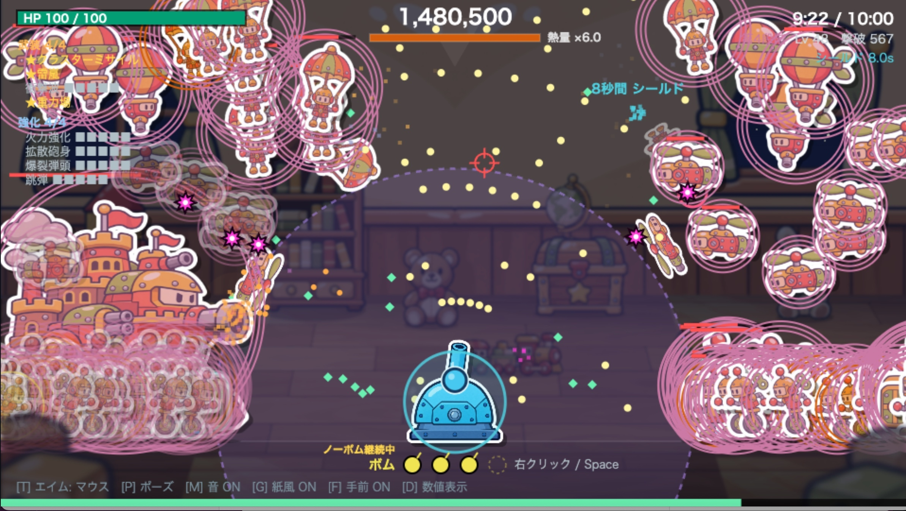

# TRIDENT WAVE

子ども部屋のジオラマを舞台にした、動けない砲台で **左・右・上の3方向** から押し寄せるおもちゃの軍団を迎え撃つ、ブラウザで遊べる防衛シューティングです。
レベルアップのたびにカードを選んで砲台を強化し、**10分間生き残れば勝ち**。9:00には最後の大ボス「大巨兵」がやってきます。



- ブラウザだけで動きます(インストール不要・マウス操作)
- 1回 10分(イベント用の 5分モードあり)
- 遊ぶたびにビルド(カードの組み合わせ)が変わるローグライト風の成長
- 上手に戦うほど敵が増えてスコアも伸びる「熱量」システムと、ランキング

---

## 遊び方

### 起動する

`index.html` をブラウザ(Chrome / Edge / Safari など)で開くだけで遊べます。

5分で終わる短縮版は、アドレスの後ろに `?mode=short` を付けて開きます。

```
index.html?mode=short
```

### 操作

| 操作 | 内容 |
|---|---|
| マウスを動かす | 狙う方向を決める(主砲は自動で連射) |
| 右クリック / Space / B | ボム(画面中の敵に大ダメージ) |
| クリック / 1〜3キー | レベルアップ時にカードを選ぶ |
| P / Esc | ポーズ |
| Esc(チュートリアル中) | チュートリアルを飛ばして本番へ |
| T | オートエイムの切り替え |
| M | 音(効果音・BGM)のオン/オフ |
| G | 紙風の表示の切り替え |
| F | 手前の積み木の表示の切り替え |
| D | 数値表示(調整用) |

### ゲームの流れ

1. タイトルでクリックすると、部屋のおもちゃと砲台がパタパタと立ち上がり、**チュートリアル** が始まります(Esc で飛ばせます)。
2. 左・右・上から来る敵を倒し、落ちる **経験値(ひし形の粒)** を集めてレベルアップ。**カードを1枚** 選んで強くなります。
3. 時間がたつと敵が強くなり(4段階)、段階の始まりには中ボス「巨兵」が来ます。
4. **9:00 に大ボス「大巨兵」** が登場。
5. **10:00 まで生き残ればクリア**。結果画面でスコアとビルドを確認し、ランキングに名前を残せます。

結果画面では「もう一度(チュートリアルなし)」か「タイトルへ(次の人へ交代)」を選べます。

---

## カード

カードは **武装4枠・強化4枠** まで持てます。どれも Lv5 まで上がります。

### 武装

| 名前 | 内容 |
|---|---|
| 地上砲台 | 左右に砲台を置き、地上の敵を撃って押し戻す |
| 対空砲台 | 上空の敵の近くで炸裂する弾を撃つ |
| 地雷 | 左右の地面に地雷を置く。地上の敵が踏むと爆発 |
| 誘導ミサイル | HPが一番高い敵を追いかけるミサイル |
| 雷撃 | 近くの敵に雷を落とし、次々と連鎖させる |
| 衝撃波 | 周りの敵を定期的に吹き飛ばし、敵の弾も消す |
| 減速フィールド | 自機の周りに入った敵の動きを遅くする |
| 標的レーザー | 敵に「標的マーク」を付ける。マークされた敵は受けるダメージが増え、倒すとスコアが増える |

### 強化

| 名前 | 内容 |
|---|---|
| 火力強化 | 全武器のダメージアップ |
| 過給機 | 主砲の連射アップ。熱量が高いほどさらに速くなるが、被弾で熱量が多く下がる |
| 拡散砲身 | 主砲の弾が増えて扇状に広がる |
| 貫通弾芯 | 主砲の弾が敵を貫通する |
| 大口径弾 | 主砲の弾が大きく強くなる(弾速は少し落ちる) |
| 爆裂弾頭 | 主砲の弾が命中時に爆発する |
| 跳弾 | 主砲の弾が画面端や地面で跳ね返る |
| 装甲板 | 最大HPアップ・受けるダメージダウン |

### ★進化

決まった **武装と強化を両方 Lv5** にすると、レベルアップ時に「★進化」が候補に出ます。

| 武装 | + 強化 | → 進化 | 効果 |
|---|---|---|---|
| 地上砲台 | 大口径弾 | **重砲台** | 一撃が重くなり、着弾点が爆発する |
| 対空砲台 | 貫通弾芯 | **高射砲陣地** | 砲身が3本に。炸裂弾が敵を貫き、何度も爆発する |
| 誘導ミサイル | 爆裂弾頭 | **クラスターミサイル** | 着弾すると子爆弾をばらまく |
| 地雷 | 跳弾 | **跳躍地雷** | 上空の敵にも反応し、地上と空中で2回爆発する |
| 雷撃 | 拡散砲身 | **雷嵐** | 雷が3本に分かれ、遠くまで連鎖する |
| 衝撃波 | 装甲板 | **反撃衝撃波** | 範囲が広がり、被弾した瞬間に強い衝撃波で反撃する |
| 減速フィールド | 火力強化 | **重力場** | 中の敵を強く減速させ、押しつぶしてダメージを与える |
| 標的レーザー | 過給機 | **賞金稼ぎ** | マークした敵のスコア×2、倒すと近くへマークが移る。熱量の上限が ×8.0 に |

組み合わせの片方を持っていると、カード選択画面にヒントが表示されます。

---

## アイテム

敵が落とすアイテムは **撃つと手に入ります**。

| アイテム | 効果 |
|---|---|
| ♥ | HP回復 |
| S | 8秒間 無敵のシールド |
| B | ボム +1(4個まで。満タンのときはスコアボーナス) |

---

## 敵

| 名前 | 特徴 |
|---|---|
| 歩兵 | 地上を歩いてくる基本の敵 |
| 突撃兵 | 地上を素早く走ってくる |
| コウモリ | 左右の空中から波打つように飛んでくる |
| 降下兵 | 上空から降りてくる |
| 重装兵 | 遅いが硬く、当たると痛い |
| 砲撃手 | 上空に留まって弾を撃ってくる |
| 巨兵 | 各段階の始まりに来る中ボス |
| 大巨兵 | 9:00 に来る最後の大ボス |

時間がたつと、色違いの上位個体(強化個体 → 精鋭個体 → 異形個体)が混ざり、硬く強くなります。窓の外も 昼 → 夕方 → 夕暮れ → 夜 と変わっていきます。

---

## スコアと熱量

画面上部のゲージが **熱量** です。

- 敵を **素早く倒し続ける** と熱量が上がります(×1.0 〜 ×6.0)。
- 熱量が高いほど **敵が増えて硬くなります** が、**倒したときのスコアも熱量倍** になります。
- **被弾・ボムの使用・囲まれること** で熱量は下がります。

上手な人ほど熱量が上がって忙しくなり、スコアも大きく伸びる仕組みです。

### スコアアップのコツ

- **ノーボムボーナス**:ボムを1回も使わずにクリアすると、20万 × 最高熱量 のボーナス
- **大巨兵の撃破ボーナス**:15万 × 熱量
- **標的マーク**:マークした敵はスコア ×1.5(賞金稼ぎなら ×2)
- **賞金稼ぎ** に進化すると熱量の上限が ×8.0 に上がります(×6.0 を超えた分はスコアだけに効き、敵は強くなりません)

結果画面には、そのプレイに合わせた「次のコツ」が1つ表示されます。

---

## ランキング

上位10人のスコアが、遊んでいる **ブラウザの中** に保存されます(10分モードと5分モードは別々)。
ランキングに入ると、その場で名前(8文字まで・日本語可)を入力できます。

※ 別のPCや別のブラウザとは共有されません。ブラウザの閲覧データを消すとランキングも消えます。

---

## 開発者向け

### ファイル構成

| ファイル | 内容 |
|---|---|
| `index.html` | ゲーム画面 |
| `config.js` | **調整用の設定**(難しさ・武器の強さ・スコア・演出の速さなど) |
| `game.js` | ゲーム本体 |
| `style.css` | ページの見た目 |
| `assets/` | 画像とBGM |

### バランス調整

難しさやバランスは `config.js` の数値を書き換えるだけで変えられます。保存してブラウザを再読み込みすると反映されます。
主な設定:

| 設定 | 内容 |
|---|---|
| `SPAWN` / `TIERS` | 敵の出現ペースと段階 |
| `ENEMY` | 敵ごとのHP・速さ・ダメージ |
| `WEAPON` / `PASSIVE` / `EVOLVE` | 武装・強化・進化の性能 |
| `HEAT` | 熱量の上がり方・下がり方と効果 |
| `SCORE` | スコアとボーナス |
| `LEVEL` | レベルアップに必要な経験値 |
| `BGM` / `INTRO` / `OUTRO` | BGMの音量、スタート演出・クリア演出の速さ |
| `RANKING` / `EVENT` | ランキングの人数、放置でタイトルに戻るまでの秒数 |

ゲーム中に **D キー** を押すと、主砲の火力・出現ペース・熱量などの数値が表示されます。

### デバッグ開始(途中から遊ぶ)

動作確認のために、URLの後ろに指定を付けると途中から始められます。チュートリアルと演出は飛ばし、ビルドは自動で作られ、ランキングには記録されません。

| 指定 | 始まり方 |
|---|---|
| `index.html?from=last` | 8:50 から(大巨兵の10秒前) |
| `index.html?from=7:30` | 7:30 から |
| `index.html?from=last&heat=6` | 熱量 ×6.0 で |
| `index.html?from=last&lv=30` | Lv30 のビルドで |
| `index.html?mode=short&from=last` | 5分モードで 4:20 から |
